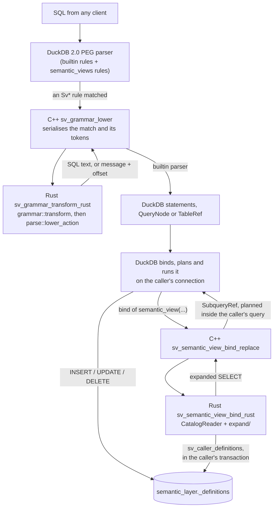

# Architecture: DuckDB Semantic Views

This note explains how the `semantic_views` extension is put together and why it has
that shape. It is for maintainers. File-by-file tables, the data-flow sketch and the
build details live in [MAINTAINER.md](../MAINTAINER.md), which this note links to
rather than repeats:

- [Source Tree](../MAINTAINER.md#source-tree) for what each module holds.
- [Data Flow](../MAINTAINER.md#data-flow) for the call chain of each statement.
- [Grammar activation](../MAINTAINER.md#grammar-activation) for how a connection gets
  the grammar.
- [Catalog Persistence](../MAINTAINER.md#catalog-persistence) for the catalog table.
- [Which DuckDB the C++ shim compiles against](../MAINTAINER.md#which-duckdb-the-c-shim-compiles-against)
  for the engine build.

The note describes the extension on DuckDB 2.0, after the parser-override hook was
removed. Every semantic-view statement is now a production of DuckDB's own PEG
grammar.

## 1. The shape in one picture

Two ideas carry most of the design:

1. **Every semantic-view statement becomes ordinary SQL before DuckDB plans it.** DDL
   lowers to DML on a catalog table, introspection lowers to a call to a read-side
   table function, and a query lowers to a subquery. DuckDB then does all the
   planning, execution, transaction handling and error rendering.
2. **Everything runs in the caller's context.** No statement runs on a connection the
   extension owns. Writes are plain DML in the caller's transaction, reads scan the
   catalog with the caller's transaction, and a query is planned as part of the
   caller's query.

## 2. Components

The extension is one loadable binary built from two languages.

**The Rust crate (`src/`)** holds every semantic decision: the grammar rules and their
transforms, the CREATE body parser, the data model, CREATE-time validation, the SQL
that each statement lowers to, the catalog reader, and query expansion. Most of it is
pure Rust with no DuckDB dependency, so `cargo test`, the proptests and the fuzz
targets exercise it directly. The parts that call DuckDB through FFI are compiled only
under the `extension` feature (see
[Feature Flag Split](../MAINTAINER.md#feature-flag-split)).

**The C++ shim (`cpp/src/shim.cpp`)** does only what needs DuckDB's C++ internals,
which the C API does not offer:

- registering the grammar extension and activating it per connection;
- the grammar bridge (`sv_grammar_lower`), which turns a matched rule into DuckDB AST
  nodes;
- registering every table and scalar function through the Catalog API, each with its
  `duckdb_functions()` description;
- the `bind_replace` of `semantic_view()`, which hands DuckDB a subquery to plan;
- reads in the caller's context (`SvCallerScope` and the `sv_caller_*` functions),
  and `SvTablePinner`, which pins the names in an expansion.

The shim does not interpret semantic-view syntax or definitions. When it needs a
decision, it calls Rust. The rule is that new logic goes to Rust and the shim stays a
bridge.

The FFI boundary uses one convention throughout. Data crosses as length-prefixed
byte buffers (the wire formats are documented in `src/grammar/tree.rs`,
`src/ddl/read_ffi.rs` and `src/query/wire.rs`). Rust returns heap buffers that C++
releases through Rust. A return code says how the call went: 0 is success, 1 is a
user-facing error, and 2 is an internal failure. Every Rust entry point wraps its body
in `catch_unwind`, so a panic never unwinds into C++. The grammar bridge goes one step
further and reports even an internal failure as rc 1, because the bridge throws rc 2
as an `InternalException`, and that can invalidate the database for every later
query.

## 3. Loading

`semantic_views_init_c_api` in `src/lib.rs` is the only exported symbol. On `LOAD` it:

1. initialises the duckdb-rs C API stubs (`duckdb_rs_extension_api_init`) against the
   C API version the extension declares (`MINIMUM_DUCKDB_VERSION`);
2. compares the host's `duckdb_library_version()` with the engine the shim was
   compiled against (`sv_compiled_duckdb_version`), and refuses a mismatch through
   `src/load_guard.rs` before anything touches host objects;
3. opens a load-time `Connection` on the database handle and runs `init_catalog`,
   which creates `semantic_layer._definitions` and runs any migrations (skipped on a
   read-only database);
4. calls each C++ registration wrapper in the `REGISTRATIONS` table, in order, and
   stops at the first failure with the wrapper's message.

The grammar is registered last (LIFE-2). Its productions lower to calls to the
read-side functions and to the `__sv_compute_create_from_yaml` helper, and
registration rolls nothing back on failure. Registering the grammar last means that a
failed `LOAD` leaves semantic-view syntax unrecognised rather than half-working.
`tests/registration_order_guard.rs` pins the order, and `tests/no_long_lived_conn.rs`
fails if `init_extension` ever allocates a connection that outlives the load again.

## 4. Entry point and C++ linkage

This section replaces the Phase 15 note `entry-point-decision.md`. The shape it chose
still holds, though the engine copy is now built differently.

**A Rust `C_STRUCT` entry point with a C++ helper.** The extension uses the C API
entry point, and C++ is a helper called after Rust has initialised. The C++ entry point
(`DUCKDB_CPP_EXTENSION_ENTRY` with `ExtensionLoader`) was tried first and failed. It
references C++ symbols that are not inlined, and the Python DuckDB build compiles with
`-fvisibility=hidden`, so those symbols did not resolve at load time. The `C_STRUCT`
ABI has a second benefit: DuckDB passes the extension the C API function table, which
`duckdb_rs_extension_api_init` installs, so every duckdb-rs call works normally. The
C++ ABI skips that step.

**The extension carries its own copy of the engine code it calls.** Compiling the shim
against the headers alone meant hand-writing stubs for each missing symbol
(constructors and destructors of `Function`, `TableFunction` and friends,
`DBConfig::GetConfig`). Each stub exposed the next missing one, and RTTI for
`GlobalTableFunctionState` finally blocked it under Python DuckDB. The fix was to link
real definitions into the extension. On DuckDB 1.x that meant compiling the
`duckdb.cpp` amalgamation with the `cc` crate. DuckDB 2.0 ships no amalgamation, so
`scripts/ensure_engine.py` now builds the engine's `duckdb_static` library from source
and `build.rs` links it. The details are in
[Which DuckDB the C++ shim compiles against](../MAINTAINER.md#which-duckdb-the-c-shim-compiles-against).

**Only the entry point is exported.** `build.rs` limits the binary's exported symbols
to `semantic_views_init_c_api`, so the engine's C++ symbols and the Rust standard
library stay local to the extension and cannot collide with the host's:

- On Linux it passes `--dynamic-list`. rustc already writes a version script for a
  cdylib, and GNU ld rejects a second one ("anonymous version tag cannot be combined
  with other version tags").
- On macOS it passes `-exported_symbols_list`.
- On Windows the `#[no_mangle]` entry point is the only `dllexport`.

**The host's database is reached by layout.** The shim gets the `DatabaseInstance`
from the C API handle by casting `duckdb_database::internal_ptr` to
`DatabaseWrapper`. That cast, and every other C++ call, depends on the host having
exactly the layout of the engine the shim was compiled against. This is why the
extension pins one exact DuckDB release.

**The ABI is `C_STRUCT` pinned to the v1.5.6 C API, not `C_STRUCT_UNSTABLE`.** DuckDB
2.0 loads an unstable-ABI extension only through a new `_init_c_api_v2` entry point.
A `C_STRUCT` extension pinned to an older C API loads through the entry point we
already have, but DuckDB then checks only that the host's C API is at least that old.
That is why the load guard in step 2 of [Loading](#3-loading) exists. It compares
version strings only, because an engine built from the PyPI sdist carries no real
source id.

The cost of this arrangement is a larger binary and a slow first engine build, which
`.engine/` caches.

## 5. The grammar

DuckDB 2.0 parses with a PEG grammar that an extension can extend. `src/grammar/` owns
our part of it: the rule text (`grammar::changes`) and the transforms
(`grammar::transform`). The shim registers the rules it receives from
`sv_grammar_changes_rust` and does not know what any rule means.

**Three shapes, three attachment points.** Each statement rule is prepended as the
first alternative of an existing DuckDB rule, and the attachment decides where the
syntax may appear:

| Shape | Prepended to | Rules | Where it may appear |
|---|---|---|---|
| query | `DescribeStatement` | `SvShowStatement`, `SvShowColumns`, `SvDescribe` | top level, subquery, CTE, view body |
| statement | `Statement` | `SvCreate`, `SvDrop`, `SvAlter` | top level only |
| table reference | `InnerTableRef` | `SvSemanticView` | wherever a table can, joins and `LATERAL` included |

Making `SHOW` and `DESCRIBE` queries is what lets `SELECT ... FROM (SHOW SEMANTIC
VIEWS)` work (TECH-DEBT #77). DuckDB also splits multi-statement strings and reports a
statement that matches no rule as its own syntax error, so the extension has no
statement splitter or front-door scanner of its own.

**CREATE's body is not in the grammar.** `SvCreate` matches the prefix and the view
name, then takes every remaining token with `SvCreateToken`, which the `ANY_TOKEN`
change overrides with DuckDB's passthrough matcher. The transform rebuilds the
statement's text from those tokens and hands it to `parse::plan_create`, the existing
body parser. The body language (`TABLES`, `RELATIONSHIPS`, `FACTS`, `DIMENSIONS`,
`METRICS`, annotations, window and semi-additive clauses, `FROM YAML`) is large and
reuses unreserved words, and DuckDB's PEG reader has no negative lookahead (it
ignores `!`). Parsing it in one Rust module keeps every CREATE form in one place. The
price is that DuckDB gives a transform tokens, not text, so whitespace inside a
stored expression is normalised and comments are dropped (TECH-DEBT #100, accepted).

The same lack of lookahead shapes the other rules. `SEMANTIC_VIEW(...)` is a flat run
of parts that the transform groups into clauses. `SHOW` tries some alternatives first
so that an optional scope name cannot swallow the next clause. The comments on
`show::RULES` and `query::RULES` explain each case.

**The grammar is active per connection.** DuckDB keeps active grammar extensions per
connection, and changing another connection's setting from the loading thread is a
data race (TECH-DEBT #103). `sv_register_grammar` therefore registers the grammar once
per database, and then:

- connections opened later activate it through an `ExtensionCallback`'s
  `OnConnectionOpened`, on their own thread;
- every connection open at load time, the loading one included, gets a
  `SemanticViewsGrammarPending` state whose `QueryBegin` / `QueryEnd` activates the
  grammar on that connection's own thread and then removes itself.

The loading connection activates when its `LOAD` ends. Another connection that was
already open parses without the grammar until it runs a statement that parses without
it, because DuckDB parses before `QueryBegin` and a statement that fails to parse
begins no query (TECH-DEBT #108). See
[Grammar activation](../MAINTAINER.md#grammar-activation).

## 6. How a statement is lowered

When a statement rule matches, DuckDB calls one of three finalize callbacks in the
shim, one for each shape. Each calls `sv_grammar_lower`:

1. `sv_grammar_span` finds the statement's own byte span and its tokens, so that a
   statement in a long multi-statement string does not cost the length of the whole
   string.
2. The match subtree and those tokens are serialised (`src/grammar/tree.rs` has the
   format) and passed to `sv_grammar_transform_rust`.
3. Rust decodes the tree, `grammar::transform` produces a `RewriteAction`, and
   `parse::lower_action` turns that into SQL text.
4. The shim parses the SQL with `sv_compat::builtin_parser()`, a parser with no
   grammar extensions, so the lowered SQL cannot re-enter our rules.

What each statement lowers to:

- **CREATE** (`RewriteAction::Create`). `plan_create` parses the body, and
  `ddl::define::enrich_definition_for_create` runs cardinality inference and the graph
  validations (`graph/`): name uniqueness, the relationship tree, facts, derived
  metrics, `USING` relationships and member-reference scoping. The result is an
  `INSERT` into `_definitions`, guarded by a `CASE ... error()` for plain CREATE or
  written as `INSERT OR IGNORE` / `INSERT OR REPLACE` for the other modes. The JSON is
  wrapped in `json_merge_patch(...)` with `now()`, `current_database()`, the target
  schema, `current_schema()`, the temporary-table list and `schema_version`. DuckDB
  evaluates those at execution, on the caller's connection.
- **CREATE ... FROM YAML FILE** (`CreateFromYamlFile`). The `INSERT` selects from the
  `__sv_compute_create_from_yaml` helper table function. Its bind reads the file
  through DuckDB's `FileSystem` with the caller's context, then parses and enriches
  the definition the same way.
- **DROP and ALTER**. The grammar transform builds the action itself, and
  `lower_action` emits the DML (`DELETE`, or an `UPDATE` of the name or of the comment
  through `json_merge_patch`) behind guards from `catalog/writes.rs`: the
  current-database check, the existence check and the rename-collision check.
- **SHOW and DESCRIBE** (`Passthrough`). These become `SELECT * FROM
  <read_side_fn>(...)` with any `LIKE`, `STARTS WITH` or `LIMIT` turned into a
  `WHERE` / `LIMIT` suffix (`parse::lower_show`, `parse::lower_name_only_read`).
- **SEMANTIC_VIEW(...)**. This becomes `SELECT * FROM semantic_view('v', dimensions
  := [...], metrics := [...], ...)`, and the shim keeps only the table reference. See
  the next section.

A write that lowers to several statements goes back to DuckDB as one
`MultiStatement`. DuckDB 2.0 serves such a statement's result from its last
row-returning statement, so the shim rewrites each guard `SELECT` that comes before
the DML into a `SET VARIABLE`, which raises the same error and returns nothing, and
then a `RESET`. The DML's `RETURNING` row is the result. Under autocommit the guards
and the DML commit separately (TECH-DEBT #27). Inside an explicit transaction they
share one snapshot.

Why lower to SQL at all, rather than to custom statement nodes? A grammar transform
must return DuckDB's own AST, and the simplest correct AST is the one DuckDB's parser
builds from SQL. Lowering writes to DML also makes them transactional for free: a
`ROLLBACK` undoes a CREATE, and the extension needs no connection and no cache that
could diverge from the table. (The in-memory catalog mirror, the separate DDL
connection and the parser-override hook are all gone for this reason.)

One consequence is easy to miss. The transform runs while DuckDB parses, before there
is any `ClientContext`. So CREATE is fully validated at parse time, a validation
failure is a parser error, and nothing in CREATE can look at the catalog or the
tables. Anything that needs the session (`now()`, the current schema, temporary
tables) is written into the SQL for DuckDB to evaluate. Member types are not stored at
all. The read side infers them when it needs them (`query/member_types.rs`).

## 7. How a query runs

`semantic_view(name, dimensions := [...], metrics := [...], facts := [...],
where_clause := '...', column_order := [...], params := row(...))` is the one query
implementation. The `SEMANTIC_VIEW(v DIMENSIONS ... METRICS ... WHERE ...)` construct
lowers to a call to it (decision D3 in `src/grammar/query.rs`). A DuckDB view over the
construct therefore stores the `semantic_view()` call and re-expands it against the
current definition each time it is queried.

`semantic_view()` is a `bind_replace` table function, like DuckDB's own `query()`. It
has no bind data, state or scan of its own. Its bind (`sv_semantic_view_bind_replace`)
does the following:

1. Reads the arguments and the caller's search path, and opens an `SvCallerScope`
   naming the caller's `ClientContext` on this thread.
2. Calls `sv_semantic_view_bind_rust`. Rust builds a `CatalogReader::for_caller()`,
   which calls back into the shim's `sv_caller_definitions`. That function scans
   `_definitions` through the storage layer with the caller's transaction, so
   uncommitted CREATE, DROP and RENAME in the same transaction are visible. It runs no
   statement, because `ClientContext::Query` from inside the caller's own bind would
   deadlock on the context lock (TECH-DEBT #19). Rust then looks up the view on the
   search path, expands wildcards, builds a `QueryRequest`, and calls
   `expand::expand`. It returns the SQL, framed with the database and schema stamped
   at CREATE.
3. Parses the SQL with the builtin parser, then moves every parse position to the
   call's own location (`sv_relocate`), so an error in generated SQL points at the
   call and not at an unrelated offset in the caller's text.
4. Pins names with `SvTablePinner`. `TABLES` entries arrive fully qualified. Other
   names in the expansion (a member subquery's tables, functions, macros, table
   functions, cast types) are resolved the way DuckDB resolves a view body stored in
   the stamped schema, so a CTE or a current schema in the caller's query cannot stand
   in for them.
5. Binds the prepared statement's parameters into `params` (TECH-DEBT #105).
6. When the call sits inside an enclosing scope, binds a copy on an isolated binder
   first, so a bare column name in a member expression fails instead of binding to a
   column of the outer query. Only `where_clause` may refer outward (TECH-DEBT #107).
7. Returns a `SubqueryRef`.

DuckDB then binds and plans that subquery as part of the caller's query. This is why
the design uses `bind_replace` (TECH-DEBT #42): the expansion runs in the caller's
transaction and session, it is optimised together with the surrounding query
(pushdown, parallel scans), results stream with no buffering, cancellation works as
for any query, and the column types are DuckDB's own.

`explain_semantic_view()` and the read-side functions behind `SHOW` and `DESCRIBE`
follow the same caller-context pattern. A C++ bind opens an `SvCallerScope`, a Rust
dispatcher reads through `CatalogReader`, and a typed row payload comes back for the
shim to emit. The dispatcher calls `sv_caller_describe` to type members and
`sv_caller_explain` to plan. A cancelled caller is checked between member-type probes
and after the dispatcher returns, and is raised as a bare `InterruptException`.

## 8. Catalog persistence

Definitions are JSON rows in `semantic_layer._definitions`, a regular DuckDB table
keyed by `(schema_name, name)`, because semantic views are scoped to a schema. Using a
real table is what makes DDL transactional and lets definitions persist with the
database file. Writes are the lowered DML from section 6, and reads are the
storage-layer scan from section 7. `init_catalog` creates the table on load and runs
the migrations, such as rebuilding a pre-scoping catalog in place and importing a
v0.1.0 companion file. A read-only database skips them, and a missing table reads as
an empty catalog. The details are in
[Catalog Persistence](../MAINTAINER.md#catalog-persistence).

## 9. Data model

`src/model.rs` defines `SemanticViewDefinition` and its parts. These structs are the
on-disk format: serde writes them as the stored JSON, and YAML export emits the same
shape. The serde surface is a compatibility contract, and the module doc lists the
frozen conventions (explicit `null`s for `source_table` and `output_type`, enum
variants in their Rust casing). New fields default on deserialisation and are skipped
when empty, so old rows keep loading. Unknown fields are ignored, so rows that still
carry removed keys load too.

The parts, in brief:

- **Tables** (`TableRef`): an alias, a physical table, declared `PRIMARY KEY` and
  `UNIQUE` columns, a comment and synonyms. Keys are logical assertions, as in
  Snowflake. The physical catalog is never consulted for them.
- **Relationships** (`Join`): a named foreign key from one alias's columns to
  another table's key columns, with a `Cardinality` that CREATE infers. Together they
  must form a tree rooted at the first table, which is the base of every expansion.
- **Facts, dimensions and metrics**: each has a name, a SQL expression, an optional
  source table, a comment, synonyms and (for facts and metrics) an access modifier.
  Metrics also carry `USING` relationships for role-playing tables,
  `NON ADDITIVE BY` dimensions for semi-additive metrics, and an optional window
  specification. A derived metric is a metric whose expression names other metrics.
- **Materializations**: a pre-aggregated table and the dimensions and metrics it
  covers.
- **Stamps**: `database_name`, `schema_name`, `resolution_schema_name`,
  `temp_tables` and `created_on`, written by the `INSERT` at CREATE. They let a query
  resolve the body's tables the way DuckDB resolves a view body, in the creating
  session's schema, and are stripped from YAML export. A `schema_version` key is
  injected into the JSON the same way but is not a field of the struct.

## 10. The expansion pipeline

`expand::expand` (in `src/expand/sql_gen.rs`) turns a definition and a `QueryRequest`
into one SQL string. It is pure Rust and DuckDB does all the data processing. At a
high level it:

1. Hoists any subqueries in `where_clause` into CTEs, so they are uncorrelated.
2. Validates the request, then resolves the requested dimensions, metrics or facts by
   name, enforcing `PRIVATE` access. Facts and metrics cannot be mixed in one request.
3. Resolves the `where_clause` members and the tables they reach.
4. Routes to a materialization when one covers the request exactly, there is no
   predicate, and no metric is semi-additive or a window metric.
5. Inlines facts into metric expressions, and metrics into derived metrics, in
   dependency order.
6. Decides the topology. A query whose metrics live at different grains gets one CTE
   per grain (`per_grain.rs`), and window and semi-additive metrics may anchor their
   CTE at a non-root table.
7. Runs the fences: fan-trap checks (`fan_trap.rs`), the role-playing path checks
   (`role_playing.rs`), and the guard against a `COUNT(*)` that would count rows that
   a `LEFT JOIN` padded with NULLs.
8. Dispatches to the per-grain, semi-additive or window emitter, or builds the plain
   `SELECT ... FROM base LEFT JOIN ... WHERE ... GROUP BY` from the PK/FK join tree
   (`join_resolver.rs`, `sql_gen.rs`).

The order matters. Topology is decided before the fences, because a per-grain or
re-anchored plan supersedes the fan-trap and role-playing errors that would reject the
base-anchored shape. A change that lets the expansion reach a new table has to teach
every fence about it. CLAUDE.md's rule on listing "the fences it walks past" exists
because that pairing was missed more than once.

## 11. Error reporting

Errors take the form DuckDB uses for the same kind of failure.

- **A statement no rule matches** gets DuckDB's own `syntax error at or near "..."`,
  with DuckDB's caret. The extension produces nothing for it. The rules accept only
  well-formed `DROP`, `ALTER` and `SHOW`, so a malformed one ends up here.
- **A matched but invalid statement** is a Rust `ParseError { message, position }`
  (`src/errors.rs`). The position is a byte offset into the whole query. CREATE adds
  its statement's offset, because the body parser sees only the statement. The bridge
  throws `ParserException(QueryLocation(position, 0), message)`, and DuckDB renders it
  as `LINE n: ... ^` in every client, the Python client included. The full message
  comes back on the heap, because the fixed error buffer would cut a long one short.
- **CREATE-time semantic errors** (graph validation, a missing key) carry no position.
  The validators work on a built definition with no spans into the text, and many of
  these failures have no single token to point at (TECH-DEBT #31). They are still
  `ParserException`s, because they are raised during parsing.
- **Write guards** raise their errors through `error()` at execution time, for
  example "already exists" and "does not exist".
- **Query-time errors** from `semantic_view()` are `BinderException`s prefixed
  `semantic_view: `. Generated SQL that fails to parse (usually a malformed
  `where_clause`) is a `ParserException` at the call's location, and binder errors in
  the expansion point at the call as well (`sv_relocate`). Cancellation is a bare
  `InterruptException`, because ADBC maps a failure to "cancelled" only on DuckDB's
  exact interrupt message.
- **Load failures** come back through each registration wrapper's error buffer as
  `Failed to register <name>: <reason>`, and a version mismatch names both versions.

## 12. Known rough edges

None of these are bugs. They are places where the shape is less clean than the rest.

- **`parse` depends on `ddl`.** `parse::native_sql` calls
  `ddl::define::enrich_definition_for_create`, and `ddl` is compiled only in the
  extension build. So CREATE lowering exists only there, and the `parse` tests that
  reach enrichment are gated on the `extension` feature. Moving enrichment next to
  `graph/`, which is always compiled, would remove the layering inversion.
- **The C++ names still say "parser".** The compat header is
  `parser_extension_compat.hpp`, and some comments in `build.rs` and the Makefile
  still speak of the parser hook. The v1.5 branches behind `SV_DUCKDB_2` are no longer
  compiled (TECH-DEBT #91).
- **CREATE text is rebuilt from tokens** (TECH-DEBT #100), and **graph errors have no
  caret** (TECH-DEBT #31). Both are accepted.
- **A connection open before `LOAD` misses the grammar for one query** (TECH-DEBT
  #103). DuckDB offers no hook that runs before parsing.
